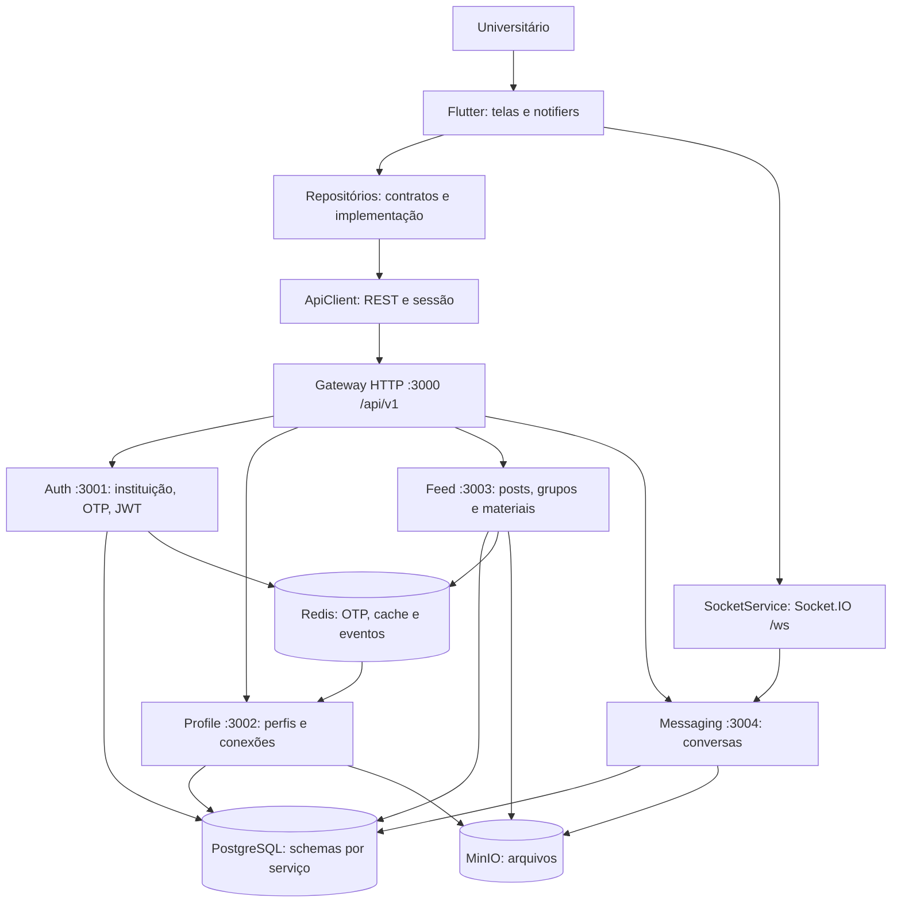

# InteraEdu

> **Rede social acadêmica** exclusiva para universitários, com identidade verificada por e-mail institucional.

## Entrega final — candidata de 25/10/2026

**Responsável:** Davi Vieira. **IA utilizada:** Claude e ChatGPT.

O pacote local inclui testes, relatórios, SDD As-Built e configuração de execução. A release oficial ainda depende da validação Docker/funcional, revisão do commit e publicação no GitHub. Na consulta de 25/10, o repositório tinha zero PRs abertos, `master` sem proteção e nenhuma release.

| Entregável | Evidência |
|---|---|
| PDF da Entrega 2 | [Relatório consolidado: dez passos, checklist e apêndices](./output/pdf/InteraEdu_Entrega_2_Relatorio_Final.pdf) |
| Especificação técnica atual | [SDD As-Built](./docs/entrega/sdd-as-built.md), [contratos HTTP/DTOs](./docs/entrega/contratos-as-built.md) e [modelos](./docs/entrega/modelos-as-built.md) |
| Testes e cobertura | [Relatório da candidata](./reports/release/relatorio.md), [JSON](./reports/release/summary.json), [JUnit](./reports/release/junit.xml) e [identificação da execução](./reports/release/run.json) |
| Reprodutibilidade | [Compose da aplicação](./compose.yaml), [Compose do harness](./compose.test.yaml) e instruções abaixo |
| Higienização | [Resultado do scan](./reports/release/hygiene.json); caches e cópias compiladas removidos, segredos gerados localmente |
| Release e governança | [Checklist de aceite](./docs/entrega/checklist-release.md), [workflow de validação](./.github/workflows/validate-release.yml) e [publicação após aprovação](./.github/workflows/publish-release.yml) |
| Demonstração e aprendizado | [Roteiro de vídeo de 4min30s](./docs/entrega/roteiro-video.md) e [retrospectiva](./docs/entrega/retrospectiva.md) |

A aprovação dos casos executados não representa cobertura total nem homologação de todos os fluxos. O relatório diferencia as integrações HTTP isoladas da validação com banco, storage e dispositivos reais. Davi confirmou que o vídeo já está gravado; falta anexar o link ao pacote.

---

## 📑 Documentação do Projeto

A documentação técnica está organizada na pasta `/docs`; as evidências e pendências da entrega estão discriminadas abaixo.

**Antes de modificar qualquer código (Flutter ou NestJS), leia a documentação.**

👉 **[Acesse o Índice Central de Documentação](./docs/README.md)** 👈

Atalhos rápidos:
- 📋 [**Resumo de Implementação**](./IMPLEMENTACAO.md) — Tudo que foi construído + como rodar + roteiro de demo
- 📐 [Padrões e Convenções de Desenvolvimento](./docs/guias/padroes-desenvolvimento.md)
- 🏗️ [Arquitetura do Sistema](./docs/arquitetura/sistema.md)
- 📊 [Status de Implementação do MVP](./docs/mvp/status-implementacao.md)
- 📜 [Walkthrough da Sessão de Implementação](./docs/walkthrough-sessao.md)

---

## Instalação e execução

Execute os comandos na raiz do repositório. Preserve `pubspec.lock` e `backend/package-lock.json`. Para execução em containers: Docker com Compose v2.20+ e Python 3.10+ para gerar a configuração. Para desenvolvimento/testes locais: Flutter **3.38.10** (SDK usado na validação local), Dart compatível com `^3.10.0`, Node.js **20** (referência dos containers/CI) e Python 3.10+. Android exige também JDK 17, Android SDK e emulador ou aparelho.

### 1. Configurar o ambiente

```bash
python .scripts/init-env.py
```

O comando cria `backend/.env` com segredos aleatórios e preserva um arquivo já existente. Como alternativa, copie `backend/.env.example` para `backend/.env` e preencha as variáveis obrigatórias. Nunca versione esse arquivo.

- `DATABASE_PASSWORD`, `JWT_ACCESS_SECRET`, `JWT_REFRESH_SECRET`, `INTERNAL_SERVICE_TOKEN`, `S3_SECRET_KEY` e `GRAFANA_ADMIN_PASSWORD`: preenchidos pelo gerador.
- `RESEND_API_KEY` e `RESEND_FROM`: envio real de OTP por Resend. A implementação atual não usa SMTP. Sem provedor configurado, o envio retorna 503.
- `ALLOW_DEV_OTP_LOG=true`: opção explícita para demonstração local com contas fictícias; o código aparece somente nos logs do auth-service em desenvolvimento. Não usar com dados reais nem em produção.
- `S3_PUBLIC_ENDPOINT`: `http://localhost:9000` para navegador no computador; para celular, usar o IP acessível do computador.
- `GOOGLE_CLIENT_ID`: opcional; sem configuração, o login Google fica indisponível.

### 2. Subir a aplicação com um comando

```bash
docker compose --env-file backend/.env up --build -d --wait
```

Frontend: [localhost:8080](http://localhost:8080). API: [localhost:3000/api/v1](http://localhost:3000/api/v1). Readiness: [health/ready](http://localhost:3000/api/v1/health/ready). Socket.IO: `http://localhost:3004/ws`.

O comando constrói o frontend web e os serviços. A execução Docker ainda deve ser validada em host com Docker; este computador não dispõe do runtime. O workflow de validação executa a stack e o smoke test quando publicado.

```bash
node .scripts/smoke-test.mjs
docker compose --env-file backend/.env logs --tail=100 gateway
docker compose --env-file backend/.env down
```

O smoke test verifica serviços reais, respostas de autenticação/validação e entrega do frontend. Ele não substitui cadastro, upload e conversa entre duas contas. O banco vazio recebe os schemas na primeira inicialização e usa sincronização TypeORM em desenvolvimento. `down` preserva os volumes; não usar `down -v` com dados que devam ser mantidos.

Observabilidade opcional: acrescentar `--profile observability` ao comando Compose. Grafana fica na porta 3030 e usa a senha gerada em `.env`.

### 3. Executar o cliente mobile ou web localmente

```bash
flutter pub get --enforce-lockfile
# Emulador Android:
flutter run --dart-define=API_BASE_URL=http://10.0.2.2:3000/api/v1 --dart-define=WS_BASE_URL=http://10.0.2.2:3004
# Navegador no computador:
flutter run -d chrome --dart-define=API_BASE_URL=http://localhost:3000/api/v1 --dart-define=WS_BASE_URL=http://localhost:3004
```

Para aparelho físico, usar o IP do computador nas URLs e em `S3_PUBLIC_ENDPOINT`, com os dispositivos na mesma rede. O aplicativo também possui configuração de servidor. O build web em container usa URLs de localhost por padrão; para acesso de outra máquina, definir `API_BASE_URL` e `WS_BASE_URL` no ambiente usado pelo Compose antes do build.

## Testes e relatórios da entrega

Instalação local das dependências, uma vez:

```bash
npm --prefix backend ci --no-audit --no-fund
flutter pub get --enforce-lockfile
```

Harness completo, com um comando:

```bash
python .scripts/run-tests.py
```

Alternativa em container, sem exigir Flutter/Node instalados no host:

```bash
docker compose -f compose.test.yaml run --build --rm harness
```

O harness compila os seis workspaces do backend, executa Jest e Flutter, retorna código diferente de zero se uma etapa falhar e grava resultados em `reports/release/`. Os testes HTTP usam servidores locais reais com dependências isoladas; não dependem de PostgreSQL/Redis/MinIO.

- [Relatório de testes e cobertura por unidade crítica](./reports/release/relatorio.md).
- [LCOV Flutter](./reports/release/flutter-lcov.info) e [LCOV backend](./reports/release/backend-coverage/lcov.info).
- [Resumo de cobertura backend](./reports/release/backend-coverage/coverage-summary.json), [JUnit](./reports/release/junit.xml) e [fontes testados](./reports/release/source-sha256.json).
- Verificação de higiene: `python .scripts/check-hygiene.py`.
- Atualização dos contratos/modelos: `node .scripts/generate-as-built.cjs`.

Resultado local de 25/10/2026: **97 testes aprovados — 36 Flutter e 61 backend**, sem falhas ou ignorados. Cobertura de linhas: **22,00% Flutter** e **23,94% backend**. Os seis pacotes backend e o build web também compilaram. Os dois arquivos Compose passaram na validação de configuração; execução dos containers e smoke test permanecem pendentes.

As imagens-base estão [fixadas por digest](./deploy/images.lock.json). O MinIO é construído de fonte oficial com revisão e checksum fixos, conforme o SDD. O primeiro build pode demorar devido à compilação do storage e do Flutter.

O detalhamento e os limites de aceite estão no [checklist de release](./docs/entrega/checklist-release.md). As evidências de 17/10 abaixo são históricas; a candidata atual usa os relatórios em `reports/release`.

---

## ⚙️ Tecnologias

| Camada | Stack |
|---|---|
| **Backend** | Node.js 20 + NestJS 10 + TypeScript, TypeORM, PostgreSQL 16, Redis 7, MinIO |
| **Mobile** | Flutter 3.38.10 (referência validada localmente), Dart ^3.10.0, Clean Architecture |
| **Infraestrutura** | Docker + Docker Compose |

---

*Para diagramas, decisões arquiteturais e guias de desenvolvimento, consulte [`/docs/README.md`](./docs/README.md).*


## Histórico de documentação e verificações anteriores

Os registros seguintes descrevem etapas anteriores. Para o estado atual, consulte a seção de entrega final no início deste README.

## Análise e correções de bugs — 12/10/2026

A revisão percorreu a arquitetura Flutter/NestJS, os contratos de autenticação,
o cliente HTTP e o serviço de conversas. As correções desta rodada concentram-se
em problemas confirmados na sessão do aplicativo e na execução dos testes.

| Problema identificado | Correção e resultado |
|---|---|
| Uma resposta 401 após renovar o token iniciava outra renovação, sem limite. | O cliente HTTP repete a requisição apenas uma vez. Se continuar sendo rejeitada, retorna `ApiException`, evitando um ciclo de requisições e rotação de tokens. |
| Login com credenciais incorretas e refresh rejeitado eram tratados como expiração automática da sessão. | Requisições POST de `/auth/` preservam o erro retornado pelo servidor e não acionam refresh automático. |
| A sessão era restaurada com qualquer access token armazenado, inclusive inválido ou expirado. | A restauração verifica `sub` e `exp`; quando necessário, tenta renovar com o refresh token. Sem sessão recuperável, limpa os tokens e permanece desautenticada. A validação criptográfica continua sendo responsabilidade do backend. |
| Após renovar na inicialização, o aplicativo ficava autenticado sem recuperar identidade e permissões. | O estado passa a carregar `userId` e `roles` do novo access token. |
| Logout mantinha o identificador e os papéis do usuário anterior em memória. | A transição para desautenticado também limpa esses campos. |
| Respostas de erro JSON como lista, `null` ou número causavam falhas de conversão de tipo. | O cliente valida a estrutura e converte mensagens para texto, devolvendo `ApiException` com o status HTTP original. |
| Mocks de `FeedRepository.createPost` não acompanhavam os parâmetros de grupo/anexo e impediam compilar testes. | Os dois mocks foram sincronizados com `groupId`, `fileBytes`, `filename` e `mimeType`, incluindo os argumentos nas invocações simuladas. |

### Validação

- `flutter test --no-pub`: **36 testes aprovados**, incluindo 11 novos testes em
  `test/network/api_client_test.dart` e `test/notifiers/auth_notifier_test.dart`.
- Análise estática dos seis arquivos Dart alterados: nenhum erro ou warning;
  uma sugestão informativa de estilo (`use_null_aware_elements`) no teste de sessão.
- O cliente HTTP aceita armazenamento e cliente de rede injetados para testar
  respostas do servidor sem depender de uma API real.

Para repetir os testes:

```bash
flutter pub get
flutter test --no-pub
flutter analyze --no-pub lib/core/network/api_client.dart lib/core/auth/auth_notifier.dart test/network/api_client_test.dart test/notifiers/auth_notifier_test.dart test/notifiers/feed_notifier_test.mocks.dart test/widgets/create_post_screen_test.mocks.dart
```

### Limitações e pendências observadas

A análise estática global (`flutter analyze --no-pub`) ainda aponta problemas
preexistentes, incluindo testes/exemplos de bibliotecas em `vendor` com dependências
próprias não resolvidas, além de sugestões de estilo e uso de contexto assíncrono
nas telas. A aprovação dos testes acima não significa que essa análise global esteja limpa.

A regeneração automática dos mocks com `build_runner` falhou porque faltam arquivos
nos pacotes `analyzer` e `_fe_analyzer_shared` do cache local; por isso, os dois mocks
foram atualizados diretamente. Em um ambiente com cache íntegro, podem ser regenerados
com `dart run build_runner build --delete-conflicting-outputs`.


## Entrega final — matriz dos itens obrigatórios

O objetivo é conectar universitários para colaboração acadêmica, compartilhamento
de materiais e descoberta de pessoas por habilidades/interesses. A relação com
o problema formal da Entrega 1 deve ser confirmada pelo grupo com o documento original.

**Repositório configurado:** [alencarrgabriel/intera_edu](https://github.com/alencarrgabriel/intera_edu).
O endereço foi lido do Git local; disponibilidade remota, publicação das alterações
e condição de repositório oficial não foram verificadas nesta etapa.

| Exigência | Material preparado/disponível | Estado e pendência real |
|---|---|---|
| Solução completa e integrada publicada | Código Flutter/NestJS, Compose e documentação | Código presente; publicar versão final e homologar integração |
| Feature branches, PRs e review entre pares | Merges locais #8–#11 e [modelo de PR](./.github/PULL_REQUEST_TEMPLATE.md) | Há histórico de PRs; anexar aprovações reais de colegas e configurar proteção |
| Commits, issues e sprints | Histórico Git com entregas e correções | Anexar board, milestones e issues vinculadas; sprints não comprovadas |
| Test harness normal e de borda | Testes em `test/`, resultado histórico de 36 aprovações e workflow manual | Execução no commit final e testes backend/integrados pendentes |
| Inspeção/correção de erros lógicos | Tabela de bugs neste README e testes de regressão | Correções documentadas; revisão humana pendente |
| Loop de re-especificação | RE-01 a RE-06 no [relatório final](./docs/entrega/relatorio-final.md#3-loop-de-re-especificação-e-critérios-verificáveis) | Refinamentos registrados; homologação do grupo pendente |
| Instalação, arquitetura e fluxo | Instruções acima, diagrama abaixo e documentação técnica | Preparados; executar roteiro no ambiente de avaliação |
| Defesa das decisões e ADRs | ADR-001 a ADR-005 no [relatório final](./docs/entrega/relatorio-final.md#2-registro-consolidado-de-decisões-de-arquitetura-adrs) | Consolidação retrospectiva; validar pelo grupo |
| Relato de experiência | Síntese técnica no relatório | Completar com contribuições e experiências reais dos integrantes |
| Comparação de ferramentas de IA | Matriz, experiência observada e protocolo de comparação no relatório | Comparativo empírico entre ferramentas ainda pendente |
| Ética, privacidade, IP e revisão humana | Discussão crítica no relatório | Texto preparado; grupo deve revisar e assumir os critérios |

### Arquitetura e fluxo da aplicação



Cadastro: e-mail institucional → OTP → verificação → cadastro/consentimento →
tokens → evento de criação de perfil. Uso autenticado: tela → repositório → API →
serviço → persistência → resposta → estado da interface. Mensagens em tempo real
usam conexão Socket.IO própria com o serviço de mensagens. O diagrama descreve o
fluxo implementado/intencionado, não certifica que todos os cenários foram homologados.

### Governança e critérios antes de cada merge

Adotar branches por tarefa, por exemplo `feat/<issue>-<descricao>`,
`fix/<issue>-<descricao>` e `docs/<issue>-<descricao>`. Abrir PR descrevendo problema,
contrato, critérios de aceitação, evidências de testes, uso de IA e limitações.
Exigir aprovação de integrante diferente do autor, resolver comentários e anexar
resultado dos checks pertinentes antes do merge. Esses critérios são a política
proposta para as próximas mudanças; não comprovam como merges anteriores ocorreram.

O administrador deve configurar proteção da branch principal no GitHub, bloquear
push direto e exigir revisão. O modelo de PR ajuda a registrar a verificação,
mas não impõe proteção por si só. Vincular issues aos PRs e usar milestone por
sprint com objetivo, responsáveis, itens entregues e retrospectiva. Registrar apenas
atividades reais; não criar evidências retroativas fictícias.

### Testes automatizados realizados — 17/10/2026

A suíte existente do aplicativo Flutter foi executada neste dispositivo com
`flutter test --no-pub --coverage --machine`, usando diretamente o SDK local
com acesso autorizado ao cache. A execução terminou com sucesso.

| Verificação | Resultado |
|---|---|
| Testes Flutter de modelos (posts, comentários e conexões), autenticação, cliente HTTP, feed e widgets (aplicativo, login e criação de post) | **36 aprovados, 0 falhas, 0 ignorados e 0 incompletos** |
| Cobertura de linhas instrumentadas do Flutter | **22,00% — 1.285 de 5.841 linhas** |
| Tentativa de executar testes dos seis workspaces do backend | **Bloqueada:** Jest não instalado; nenhum arquivo de teste ou configuração Jest encontrado no backend |

Evidências e resultados detalhados:

- [Relatório completo, com cada caso executado](./reports/testes/relatorio.md).
- [Resumo dos resultados em JSON](./reports/testes/resumo.json).
- [Relatório JUnit XML](./reports/testes/junit.xml).
- [Eventos da execução Flutter em JSONL](./reports/testes/flutter-final.jsonl).
- [Cobertura em formato LCOV](./reports/testes/lcov.info).
- [Saída da tentativa de testes do backend](./reports/testes/backend-output.txt).

Para repetir a avaliação e gerar os relatórios, consulte as instruções no
[relatório completo](./reports/testes/relatorio.md) e o
[gerador de relatórios](./.scripts/gerar-relatorio-testes.py).
A cobertura informada não representa cobertura de requisitos ou do backend.
Não foram executados testes ponta a ponta com PostgreSQL, Redis, SMTP, MinIO
ou dispositivos reais; a integração de cadastro/OTP, permissões, uploads e
WebSocket ainda precisa de homologação. Esta rodada não reavaliou a análise
estática global nem o build do backend.

### Workflow remoto de testes Flutter

Foi adicionado o workflow manual [Validar testes Flutter](./.github/workflows/validate-flutter.yml).
Após publicar a alteração, um integrante pode executá-lo em GitHub Actions e
baixar o artefato `flutter-tests-<commit>` com o resultado em JSONL. As dependências
serão resolvidas no runner remoto. O workflow foi escrito, mas **não foi disparado
nem validado nesta etapa**, e não testa backend ou integração.

O grupo deve entregar URL da execução remota, commit, resultado e log. A execução
local de 17/10/2026 aprovou 36 testes, conforme os relatórios acima. Ainda faltam
evidências de integração de cadastro/OTP, permissões, uploads e WebSocket, além
de testes e build do backend. A análise estática global continua com pendências.

### Roteiro de homologação e apresentação

No ambiente de avaliação escolhido pelo grupo:

1. Registrar versão/commit, configurar serviços e verificar disponibilidade da API.
2. Cadastrar conta com domínio permitido, verificar OTP e criação do perfil;
   rejeitar domínio não permitido, OTP inválido/expirado e credenciais incorretas.
3. Restaurar sessão, verificar logout e conferir acesso protegido com outra conta.
4. Editar perfil, solicitar/aceitar conexão e conferir restrições de privacidade.
5. Publicar e consultar conteúdo, reagir/comentar e validar anexos e limites.
6. Enviar mensagem entre duas contas e verificar persistência e reconexão.
7. Anotar esperado/obtido, data, responsável, falha/issue e evidência sem dados pessoais.

Os passos são critérios de aceitação propostos, não resultados já obtidos.

### Pacote documental pronto e fechamento pelo grupo

O [relatório técnico final](./docs/entrega/relatorio-final.md) reúne ADRs,
re-especificação, testes e lacunas, análise crítica de IA e relato técnico.
Pode compor o relatório acadêmico após revisão dos integrantes. O README serve
como índice e matriz de rastreabilidade da entrega.

Antes de declarar a entrega concluída, o grupo deve publicar o commit final,
confirmar o repositório oficial, anexar revisões de colegas e evidências de
issues/sprints, executar a homologação e completar a comparação real entre
ferramentas de IA. Nesta etapa foram preparados arquivos e documentação, sem
execução da aplicação, instalação de dependências ou publicação no GitHub.
