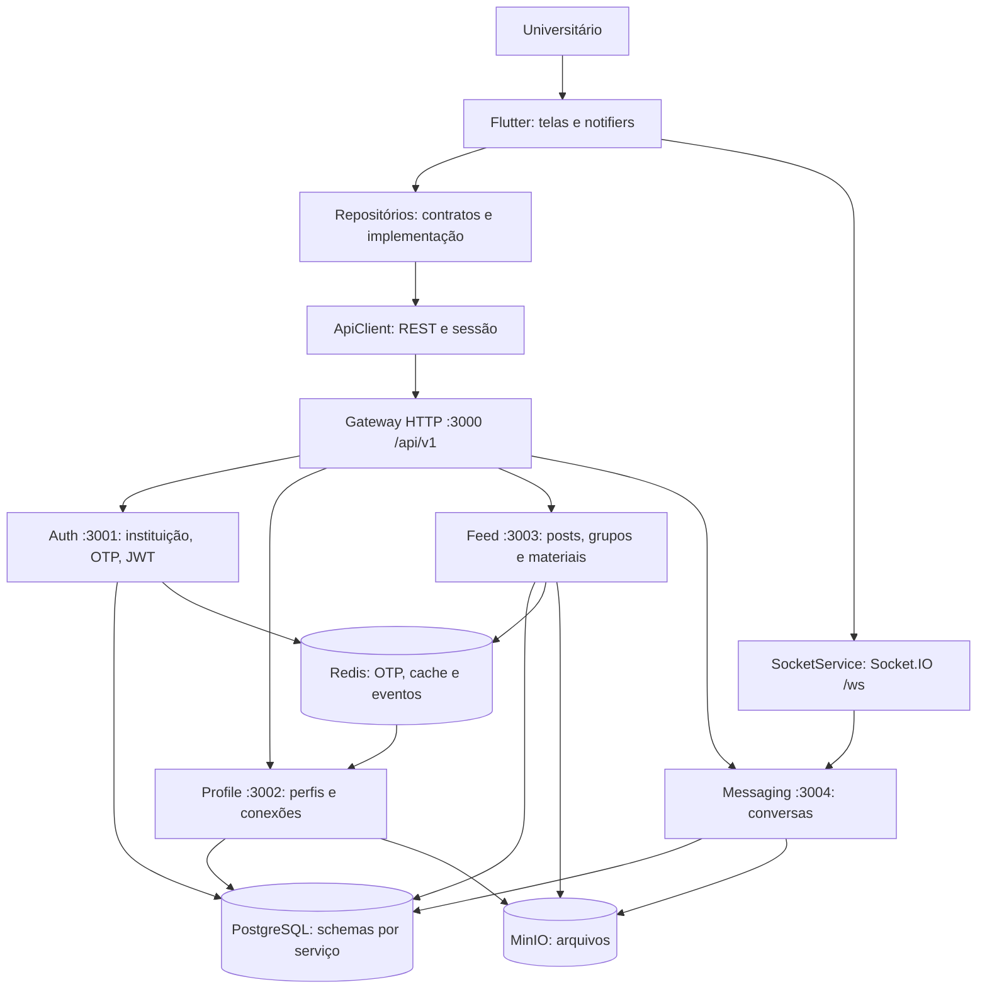

# InteraEdu

> **Rede social acadêmica** exclusiva para universitários, com identidade verificada por e-mail institucional.

**Cobertura declarada na documentação anterior:** 45 de 50 requisitos funcionais (90%). Esse número não foi revalidado nesta revisão e não comprova integração completa. Veja o [Resumo de Implementação](./IMPLEMENTACAO.md) e a matriz de entrega abaixo.

---

## 📑 Documentação do Projeto

A documentação técnica está organizada na pasta `/docs`; as evidências e pendências da entrega estão discriminadas abaixo.

**Antes de modificar qualquer código (Flutter ou NestJS), leia a documentação.**

👉 **[Acesse o Índice Central de Documentação](./docs/README.md)** 👈

Atalhos rápidos:
- 📋 [**Resumo de Implementação**](./IMPLEMENTACAO.md) — Tudo que foi construído + como rodar + roteiro de demo
- 📐 [Padrões e Convenções de Desenvolvimento](./docs/guias/padroes-desenvolvimento.md)
- 🏗️ [Arquitetura do Sistema](./docs/arquitetura/sistema.md)
- 📊 [Status de Implementação do MVP](./docs/mvp/status-implementacao.md)
- 📜 [Walkthrough da Sessão de Implementação](./docs/walkthrough-sessao.md)

---

## ⚡ Como Rodar o Projeto Localmente

> Instruções para o ambiente de avaliação do grupo. Nesta etapa documental não
> foram executados Flutter, aplicação ou downloads de dependências neste dispositivo.
> A execução de testes citada mais abaixo pertence à etapa anterior.

Pré-requisitos do ambiente de avaliação: Git, Docker com Compose v2 e Flutter
3.44.4 (mesma referência do workflow existente), com Dart compatível com
`^3.10.0`. Para Android, JDK 17 e Android SDK/emulador; para web, Chrome.
Node 20 é usado pelos Dockerfiles; instalação local só é necessária ao desenvolver
backend fora dos containers. Manter `pubspec.lock` e `backend/package-lock.json`.

Clone o [repositório configurado](https://github.com/alencarrgabriel/intera_edu)
e entre em `intera_edu`. Registre o commit usado para avaliação. Configure
`backend/.env` a partir do exemplo, com segredos próprios, SMTP e armazenamento.
Em PowerShell, use `Copy-Item .env.example .env` dentro de `backend`.
O Compose contém valores e portas de desenvolvimento: não constitui configuração
de produção. Banco vazio usa `backend/scripts/init-db.sql` na primeira inicialização;
não apague volumes para repetir uma demonstração com dados importantes.


### 1. Backend (Microsserviços em Docker)

```bash
cd backend
cp .env.example .env  # preencha as variáveis de ambiente
docker compose up --build
```

> O API Gateway ficará disponível em: `http://localhost:3000/api/v1`

### 2. App Mobile (Flutter)

```bash
# Na raiz do projeto:
flutter pub get

# Emulador Android:
flutter run --dart-define=API_BASE_URL=http://10.0.2.2:3000/api/v1 --dart-define=WS_BASE_URL=http://10.0.2.2:3004

# Web em ambiente de desenvolvimento:
flutter run -d chrome --dart-define=API_BASE_URL=http://localhost:3000/api/v1 --dart-define=WS_BASE_URL=http://localhost:3004
```

---

## ⚙️ Tecnologias

| Camada | Stack |
|---|---|
| **Backend** | Node.js 20 + NestJS 10 + TypeScript, TypeORM, PostgreSQL 16, Redis 7, MinIO |
| **Mobile** | Flutter 3.44.4 (referência do workflow), Dart ^3.10.0, Clean Architecture |
| **Infraestrutura** | Docker + Docker Compose |

---

*Para diagramas, decisões arquiteturais e guias de desenvolvimento, consulte [`/docs/README.md`](./docs/README.md).*


## Análise e correções de bugs — 12/10/2026

A revisão percorreu a arquitetura Flutter/NestJS, os contratos de autenticação,
o cliente HTTP e o serviço de conversas. As correções desta rodada concentram-se
em problemas confirmados na sessão do aplicativo e na execução dos testes.

| Problema identificado | Correção e resultado |
|---|---|
| Uma resposta 401 após renovar o token iniciava outra renovação, sem limite. | O cliente HTTP repete a requisição apenas uma vez. Se continuar sendo rejeitada, retorna `ApiException`, evitando um ciclo de requisições e rotação de tokens. |
| Login com credenciais incorretas e refresh rejeitado eram tratados como expiração automática da sessão. | Requisições POST de `/auth/` preservam o erro retornado pelo servidor e não acionam refresh automático. |
| A sessão era restaurada com qualquer access token armazenado, inclusive inválido ou expirado. | A restauração verifica `sub` e `exp`; quando necessário, tenta renovar com o refresh token. Sem sessão recuperável, limpa os tokens e permanece desautenticada. A validação criptográfica continua sendo responsabilidade do backend. |
| Após renovar na inicialização, o aplicativo ficava autenticado sem recuperar identidade e permissões. | O estado passa a carregar `userId` e `roles` do novo access token. |
| Logout mantinha o identificador e os papéis do usuário anterior em memória. | A transição para desautenticado também limpa esses campos. |
| Respostas de erro JSON como lista, `null` ou número causavam falhas de conversão de tipo. | O cliente valida a estrutura e converte mensagens para texto, devolvendo `ApiException` com o status HTTP original. |
| Mocks de `FeedRepository.createPost` não acompanhavam os parâmetros de grupo/anexo e impediam compilar testes. | Os dois mocks foram sincronizados com `groupId`, `fileBytes`, `filename` e `mimeType`, incluindo os argumentos nas invocações simuladas. |

### Validação

- `flutter test --no-pub`: **36 testes aprovados**, incluindo 11 novos testes em
  `test/network/api_client_test.dart` e `test/notifiers/auth_notifier_test.dart`.
- Análise estática dos seis arquivos Dart alterados: nenhum erro ou warning;
  uma sugestão informativa de estilo (`use_null_aware_elements`) no teste de sessão.
- O cliente HTTP aceita armazenamento e cliente de rede injetados para testar
  respostas do servidor sem depender de uma API real.

Para repetir os testes:

```bash
flutter pub get
flutter test --no-pub
flutter analyze --no-pub lib/core/network/api_client.dart lib/core/auth/auth_notifier.dart test/network/api_client_test.dart test/notifiers/auth_notifier_test.dart test/notifiers/feed_notifier_test.mocks.dart test/widgets/create_post_screen_test.mocks.dart
```

### Limitações e pendências observadas

A análise estática global (`flutter analyze --no-pub`) ainda aponta problemas
preexistentes, incluindo testes/exemplos de bibliotecas em `vendor` com dependências
próprias não resolvidas, além de sugestões de estilo e uso de contexto assíncrono
nas telas. A aprovação dos testes acima não significa que essa análise global esteja limpa.

A regeneração automática dos mocks com `build_runner` falhou porque faltam arquivos
nos pacotes `analyzer` e `_fe_analyzer_shared` do cache local; por isso, os dois mocks
foram atualizados diretamente. Em um ambiente com cache íntegro, podem ser regenerados
com `dart run build_runner build --delete-conflicting-outputs`.


## Entrega final — matriz dos itens obrigatórios

O objetivo é conectar universitários para colaboração acadêmica, compartilhamento
de materiais e descoberta de pessoas por habilidades/interesses. A relação com
o problema formal da Entrega 1 deve ser confirmada pelo grupo com o documento original.

**Repositório configurado:** [alencarrgabriel/intera_edu](https://github.com/alencarrgabriel/intera_edu).
O endereço foi lido do Git local; disponibilidade remota, publicação das alterações
e condição de repositório oficial não foram verificadas nesta etapa.

| Exigência | Material preparado/disponível | Estado e pendência real |
|---|---|---|
| Solução completa e integrada publicada | Código Flutter/NestJS, Compose e documentação | Código presente; publicar versão final e homologar integração |
| Feature branches, PRs e review entre pares | Merges locais #8–#11 e [modelo de PR](./.github/PULL_REQUEST_TEMPLATE.md) | Há histórico de PRs; anexar aprovações reais de colegas e configurar proteção |
| Commits, issues e sprints | Histórico Git com entregas e correções | Anexar board, milestones e issues vinculadas; sprints não comprovadas |
| Test harness normal e de borda | Testes em `test/`, resultado histórico de 36 aprovações e workflow manual | Execução no commit final e testes backend/integrados pendentes |
| Inspeção/correção de erros lógicos | Tabela de bugs neste README e testes de regressão | Correções documentadas; revisão humana pendente |
| Loop de re-especificação | RE-01 a RE-06 no [relatório final](./docs/entrega/relatorio-final.md#3-loop-de-re-especificação-e-critérios-verificáveis) | Refinamentos registrados; homologação do grupo pendente |
| Instalação, arquitetura e fluxo | Instruções acima, diagrama abaixo e documentação técnica | Preparados; executar roteiro no ambiente de avaliação |
| Defesa das decisões e ADRs | ADR-001 a ADR-005 no [relatório final](./docs/entrega/relatorio-final.md#2-registro-consolidado-de-decisões-de-arquitetura-adrs) | Consolidação retrospectiva; validar pelo grupo |
| Relato de experiência | Síntese técnica no relatório | Completar com contribuições e experiências reais dos integrantes |
| Comparação de ferramentas de IA | Matriz, experiência observada e protocolo de comparação no relatório | Comparativo empírico entre ferramentas ainda pendente |
| Ética, privacidade, IP e revisão humana | Discussão crítica no relatório | Texto preparado; grupo deve revisar e assumir os critérios |

### Arquitetura e fluxo da aplicação



Cadastro: e-mail institucional → OTP → verificação → cadastro/consentimento →
tokens → evento de criação de perfil. Uso autenticado: tela → repositório → API →
serviço → persistência → resposta → estado da interface. Mensagens em tempo real
usam conexão Socket.IO própria com o serviço de mensagens. O diagrama descreve o
fluxo implementado/intencionado, não certifica que todos os cenários foram homologados.

### Governança e critérios antes de cada merge

Adotar branches por tarefa, por exemplo `feat/<issue>-<descricao>`,
`fix/<issue>-<descricao>` e `docs/<issue>-<descricao>`. Abrir PR descrevendo problema,
contrato, critérios de aceitação, evidências de testes, uso de IA e limitações.
Exigir aprovação de integrante diferente do autor, resolver comentários e anexar
resultado dos checks pertinentes antes do merge. Esses critérios são a política
proposta para as próximas mudanças; não comprovam como merges anteriores ocorreram.

O administrador deve configurar proteção da branch principal no GitHub, bloquear
push direto e exigir revisão. O modelo de PR ajuda a registrar a verificação,
mas não impõe proteção por si só. Vincular issues aos PRs e usar milestone por
sprint com objetivo, responsáveis, itens entregues e retrospectiva. Registrar apenas
atividades reais; não criar evidências retroativas fictícias.

### Evidência de testes sem usar este dispositivo

Foi adicionado o workflow manual [Validar testes Flutter](./.github/workflows/validate-flutter.yml).
Após publicar a alteração, um integrante pode executá-lo em GitHub Actions e
baixar o artefato `flutter-tests-<commit>` com o resultado em JSONL. As dependências
serão resolvidas no runner remoto. O workflow foi escrito, mas **não foi disparado
nem validado nesta etapa**, e não testa backend ou integração.

O grupo deve entregar URL da execução, commit, resultado e log. A suíte anterior
aprovou 36 testes, mas isso não substitui um test harness completo. Ainda faltam
evidências de integração de cadastro/OTP, permissões, uploads e WebSocket, além
de testes e build do backend. A análise estática global continua com pendências.

### Roteiro de homologação e apresentação

No ambiente de avaliação escolhido pelo grupo:

1. Registrar versão/commit, configurar serviços e verificar disponibilidade da API.
2. Cadastrar conta com domínio permitido, verificar OTP e criação do perfil;
   rejeitar domínio não permitido, OTP inválido/expirado e credenciais incorretas.
3. Restaurar sessão, verificar logout e conferir acesso protegido com outra conta.
4. Editar perfil, solicitar/aceitar conexão e conferir restrições de privacidade.
5. Publicar e consultar conteúdo, reagir/comentar e validar anexos e limites.
6. Enviar mensagem entre duas contas e verificar persistência e reconexão.
7. Anotar esperado/obtido, data, responsável, falha/issue e evidência sem dados pessoais.

Os passos são critérios de aceitação propostos, não resultados já obtidos.

### Pacote documental pronto e fechamento pelo grupo

O [relatório técnico final](./docs/entrega/relatorio-final.md) reúne ADRs,
re-especificação, testes e lacunas, análise crítica de IA e relato técnico.
Pode compor o relatório acadêmico após revisão dos integrantes. O README serve
como índice e matriz de rastreabilidade da entrega.

Antes de declarar a entrega concluída, o grupo deve publicar o commit final,
confirmar o repositório oficial, anexar revisões de colegas e evidências de
issues/sprints, executar a homologação e completar a comparação real entre
ferramentas de IA. Nesta etapa foram preparados arquivos e documentação, sem
execução da aplicação, instalação de dependências ou publicação no GitHub.
