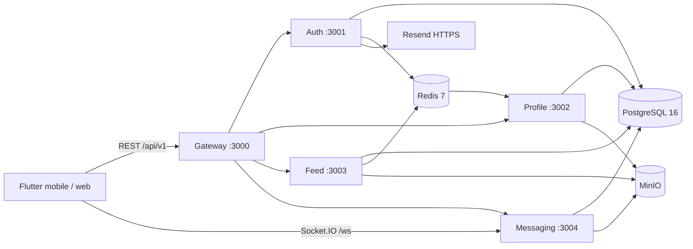

# SDD As-Built — InteraEdu

Responsável: **Davi Vieira**. Revisão: **25/10/2026**.

Este documento descreve a candidata à entrega presente na árvore de trabalho. A versão estável só fica identificada após revisão, integração na `main` e publicação da tag. O [registro da execução](../../reports/release/run.json) informa commit-base e alterações locais; o [manifesto SHA-256](../../reports/release/source-sha256.json) identifica os fontes testados. Não há aprovação de release implícita neste documento.

## 1. Escopo entregue

InteraEdu é uma aplicação acadêmica em Flutter, com backend NestJS. O código contém cadastro institucional com OTP, login e recuperação de senha, perfil e privacidade, conexões, feed local/global, posts e comentários, reações, grupos e disciplinas, materiais, favoritos, stories, hashtags, menções, notificações e conversas. A presença de uma implementação não equivale a homologação funcional de todos os fluxos.

As telas e rotas são definidas em [app_router.dart](../../lib/core/router/app_router.dart); composição e injeção em [service_locator.dart](../../lib/core/di/service_locator.dart). A camada `presentation` usa notifiers; `domain` define entidades e contratos; `data` implementa repositórios e conversão JSON; `core` concentra sessão, rede, configuração e navegação.

## 2. Arquitetura efetiva

| Componente | Implementação e responsabilidade |
|---|---|
| Gateway | Proxy HTTP para quatro serviços, encaminhamento multipart, normalização de erros JSON, throttling, métricas e healthchecks. A validação JWT de rotas de negócio ocorre nos serviços. |
| Auth | Credenciais, instituições, OTP, pares JWT, consentimentos, recuperação de senha e login Google opcional. |
| Profile | Perfis, habilidades, conexões, bloqueios, sugestões e consumo de eventos de cadastro. |
| Feed | Posts, feed, comentários, reações, grupos, disciplinas, materiais, stories, favoritos, menções e denúncias. A geração de feed está em `PostsService`; o módulo vazio antigo foi removido. |
| Messaging | Chats, membros, mensagens e anexos, notificações, gateway Socket.IO. |
| Shared | Guard e estratégia JWT, decorators, Redis, configuração TypeORM, auditoria, DTOs comuns e healthcheck. |

O banco de desenvolvimento é único, com schemas `auth`, `profile`, `feed`, `messaging` e `audit`. A separação é lógica: existem consultas SQL entre schemas no perfil/conexões/exportação. Portanto, esta versão não implementa isolamento físico completo de bancos por serviço. O usuário de banco é compartilhado no Compose.

Redis Pub/Sub em `interaedu.events` oferece comunicação best-effort, sem confirmação durável de consumo. A geração de perfil após cadastro depende desse fluxo; sua entrega com banco real ainda precisa de homologação.

## 3. Contratos HTTP e dados

O [inventário de contratos](./contratos-as-built.md) foi extraído dos controllers por AST TypeScript e contém **93 entradas de rota**, suas assinaturas, status declarados e **13 arquivos de DTO TypeScript**. O [inventário de modelos](./modelos-as-built.md) contém **31 entidades TypeORM**. Os fontes vinculados integram esta especificação e são a referência para validação, índices e relações.

Base externa: `http://localhost:3000/api/v1`. Caminhos internos não possuem esse prefixo. O gateway encaminha `Authorization: Bearer <access_token>` e `X-Request-ID`. As rotas precisam corresponder ao prefixo inteiro (`/users` ou `/users/...`); nomes semelhantes, como `/users-evil`, são rejeitados.

| Operação principal | Entrada e resultado |
|---|---|
| `POST /auth/register` | `{email}` validado como email; domínio institucional e duplicidade verificados; 202 com mensagem e `expires_in_seconds: 600`. |
| `POST /auth/verify-otp` | `{email, code}`; OTP válido gera `temporary_token`, validade 900 segundos. |
| `POST /auth/complete-registration` | Token temporário, senha, nome, campos opcionais e consentimento conforme DTO; retorna usuário e tokens. A propagação de todos os campos para o perfil depende da implementação do evento. |
| `POST /auth/login` | `{email, password}`; 200 com `tokens` e `requires_consent_update`; dados inválidos retornam erro. |
| `POST /auth/refresh` | `{refresh_token}`; revoga o token encontrado e retorna novo par. |
| `POST /auth/accept-terms` e `/auth/revoke-consent` | Identidade obtida do JWT; `user_id` enviado no corpo não escolhe o titular. |
| `GET /users/me`, `PATCH /users/me` | Consulta e edição do perfil autenticado. Upload de avatar usa `POST /users/me/avatar`. |
| `GET /posts` | `scope`, `cursor`, `limit`; retorna `{data, pagination: {cursor, has_more}}`. |
| `POST /posts` | Texto de até 5.000 caracteres, `scope` local/global, URLs opcionais e arquivo multipart `file` quando aplicável. |
| `POST /chats` | Tipo direct/group, `member_ids` e nome opcional; chat direto exige dois membros distintos; grupo inicial limita 50. |
| `GET/POST /chats/:id/messages` | Consulta exige participação; envio exige texto não vazio ou arquivo. |
| `POST /notifications/internal` | Token `X-Internal-Token` obrigatório e igual a `INTERNAL_SERVICE_TOKEN`; JWT de usuário não substitui esse token. |

O gateway normaliza erros downstream para `{error: {code, message, status, timestamp}}`, quando recebe erro HTTP JSON. Os serviços diretamente acessados podem retornar o formato padrão Nest `{statusCode, message, error}`. Alguns handlers têm respostas próprias e erros multipart específicos; não há envelope universal de sucesso.

DTOs com decorators são validados pelo `ValidationPipe`. Corpos inline ou `any` dependem de verificações explícitas no serviço; não se deve supor validação declarativa completa em todas as rotas.

## 4. Sessão, segurança e privacidade

O access token carrega `sub`, `email`, `institution_id` e `roles`. O padrão configurado é 15 minutos para access token e 7 dias para refresh. Refresh tokens são persistidos como hash bcrypt. O frontend armazena tokens via secure storage, verifica validade temporal na restauração e limita a uma repetição após refresh no cliente HTTP. A verificação criptográfica ocorre no backend.

OTP tem TTL de 600 segundos, limite de três solicitações por hora/email e bloqueio de 900 segundos ao atingir o limite de tentativas. O código atual aciona bloqueio ao incrementar a quinta tentativa, antes da comparação do código. Isso deve ser considerado na homologação da experiência do usuário. O transporte implementado é Resend via HTTPS. Sem configuração de envio, retorna 503; logs com OTP exigem explicitamente `NODE_ENV=development` e `ALLOW_DEV_OTP_LOG=true`, para contas fictícias de demonstração.

Perfis usam `public`, `local_only` e `private`; as verificações combinam instituição e conexão aceita. A mesma instituição não substitui conexão no perfil privado. Não há uma evidência e2e completa dessas combinações nesta rodada.

Segredos do Compose foram retirados dos defaults e passaram a ser obrigatórios em `.env`. O gerador local cria valores aleatórios e não sobrescreve configuração existente. O scan [hygiene.json](../../reports/release/hygiene.json) cobre padrões conhecidos na árvore atual; não é auditoria de todo o histórico Git.

## 5. Feed e paginação

O feed usa Redis por 60 segundos. A chave inclui escopo, instituição, usuário, cursor e limite, para não compartilhar reações/favoritos de um usuário com outro. A invalidação atual depende do TTL; a função de invalidação apenas registra a solicitação. Alterações podem levar até esse intervalo para aparecer em consultas com cache.

O feed global reserva parte da consulta a outras instituições (20%, com arredondamento); a existência de conteúdo e a paginação influenciam o resultado. O feed local pode completar a primeira página com conteúdo externo quando há menos de cinco itens. O cursor de posts codifica JSON com data (`{t: ISO}`) em Base64. O cursor de mensagens codifica diretamente a data ISO em Base64. Não são formatos intercambiáveis.

`listChats` retorna no máximo 30 conversas, `has_more: false`; os parâmetros `type` e `cursor` recebidos ainda não implementam paginação completa dessa lista.

## 6. Arquivos e tempo real

Uploads de avatar aceitam JPEG/PNG/WebP e até 5 MB. Posts e mensagens aceitam JPEG/PNG/WebP/PDF e até 10 MB. Arquivos são armazenados via S3/MinIO; a URL devolvida usa `S3_PUBLIC_ENDPOINT`, que deve ser alcançável pelo dispositivo.

A política atual dos serviços torna os objetos do bucket legíveis publicamente. Isso limita a privacidade dos anexos: a autorização de uma conversa não torna a URL do objeto privada. Uma implantação para dados reais requer decisão explícita e evolução para objetos privados/URLs assinadas.

Socket.IO usa a porta 3004 e namespace `/ws`, com JWT em `handshake.auth.token`. Eventos recebidos: `message:send` (`chatId`, `content`), `typing:start` e `typing:stop` (`chatId`). Eventos emitidos: `message:new` e `typing:indicator`. O envio de mensagem consulta a participação no chat. A conectividade/reconexão entre dispositivos ainda não foi homologada nesta rodada.

## 7. Empacotamento e operação

- [compose.yaml](../../compose.yaml): inclui backend e frontend web servido por Nginx na porta 8080.
- [Compose backend](../../backend/docker-compose.yml): PostgreSQL 16, Redis 7, MinIO e cinco serviços Node. Observabilidade é opt-in pelo profile `observability`.
- [Dockerfile.web](../../Dockerfile.web): build Flutter 3.38.10 e servidor Nginx.
- [compose.test.yaml](../../compose.test.yaml) e [Dockerfile.test](../../Dockerfile.test): harness isolado, sem necessidade de banco para unitários/integrações HTTP locais.
- `GET /api/v1/health`: liveness do gateway. `GET /api/v1/health/ready`: consulta `/health` dos quatro serviços, retorna 503 se algum estiver indisponível. Não comprova integridade funcional do banco ou entrega de eventos.

O ambiente usa `NODE_ENV=development` e sincronização automática de entidades TypeORM. É um ambiente de demonstração, não um procedimento de migração/implantação de produção. As versões de pacotes são travadas nos lockfiles e as imagens-base foram fixadas por digest em [images.lock.json](../../deploy/images.lock.json). O MinIO é compilado de uma revisão oficial fixa com checksum do arquivo-fonte, pois a imagem anterior deixou de ser acessível. Isso fixa as entradas principais do build; não é uma comprovação de builds bit a bit idênticos. O Compose ainda precisa ser executado e validado em host com Docker.

## 8. Verificação e aceite

A evidência atual está no [relatório de validação](../../reports/release/relatorio.md), com casos, cobertura por unidade crítica, logs, JUnit e fontes identificados. Os testes de integração usam HTTP real e dependências isoladas; não equivalem à homologação de toda a stack.

O [checklist de liberação](./checklist-release.md) distingue preparação local, validação Docker, aprovação do commit, proteção da `main`, publicação e vídeo. Este SDD deve ser regenerado/revisado se houver mudanças de contrato antes da tag final.

## 9. Proveniência do storage

O [Dockerfile do MinIO](../../backend/storage/Dockerfile) usa o commit `9e49d5e7a648f00e26f2246f4dc28e6b07f8c84a` da [release oficial RELEASE.2025-10-15T17-29-55Z](https://github.com/minio/minio/releases/tag/RELEASE.2025-10-15T17-29-55Z), com Go 1.24.8 conforme o go.mod dessa revisão. A licença AGPL-3.0 acompanha a imagem. A construção desse container ainda depende da execução Docker; a disponibilidade do código-fonte e das imagens-base foi verificada separadamente.
